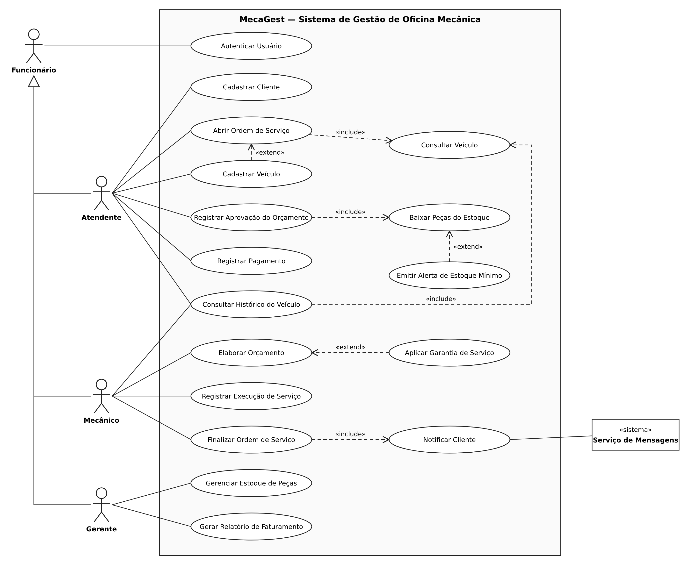

# MecaGest — Casos de Uso

## 1. Diagrama de Casos de Uso

Arquivo editável: [`diagramas/casos-de-uso.drawio`](diagramas/casos-de-uso.drawio) (abrir no Draw.io).

### 1.1 Atores

| Ator | Tipo | Papel |
| --- | --- | --- |
| Funcionário | Principal (geral) | Papel genérico de quem acessa o sistema. Não é usado diretamente: existe para que Atendente, Mecânico e Gerente herdem a associação com `Autenticar Usuário` |
| Atendente | Principal | Cadastra clientes e veículos, abre ordens de serviço, registra a aprovação do orçamento e o pagamento |
| Mecânico | Principal | Elabora o orçamento, registra a execução dos serviços e finaliza a ordem de serviço |
| Gerente | Principal | Gerencia o estoque de peças e gera o relatório de faturamento |
| Serviço de Mensagens | Secundário (sistema externo) | Recebe do MecaGest a mensagem e a entrega ao cliente (SMS ou WhatsApp) |

O **cliente** da oficina não é ator do sistema: ele interage de forma indireta, por meio do Atendente (balcão e telefone) e recebendo a notificação do Serviço de Mensagens.

### 1.2 Relacionamentos entre casos de uso

| Relacionamento | Justificativa |
| --- | --- |
| Atendente, Mecânico e Gerente **generalizam** Funcionário | Todos se autenticam do mesmo jeito (RF-01), e cada um tem casos de uso próprios do seu perfil (RN-08) |
| Abrir Ordem de Serviço `<<include>>` Consultar Veículo | Toda abertura de OS começa localizando o veículo pela placa |
| Consultar Histórico do Veículo `<<include>>` Consultar Veículo | O histórico sempre parte da busca do veículo pela placa (RF-13) |
| Registrar Aprovação do Orçamento `<<include>>` Baixar Peças do Estoque | Toda aprovação baixa as peças do estoque automaticamente (RF-08) |
| Finalizar Ordem de Serviço `<<include>>` Notificar Cliente | Sempre que a OS fica pronta, o cliente é avisado (RF-11) |
| Cadastrar Veículo `<<extend>>` Abrir Ordem de Serviço | Só acontece se o veículo ainda não estiver cadastrado |
| Emitir Alerta de Estoque Mínimo `<<extend>>` Baixar Peças do Estoque | Só acontece se alguma peça ficar igual ou abaixo do estoque mínimo (RF-10) |
| Aplicar Garantia de Serviço `<<extend>>` Elaborar Orçamento | Só acontece se o mesmo serviço foi feito no veículo nos últimos 90 dias (RN-07) |

### 1.3 Rastreabilidade: casos de uso x requisitos

| Caso de uso | Requisitos e regras atendidos |
| --- | --- |
| Autenticar Usuário | RF-01, RNF-03, RN-08 |
| Cadastrar Cliente | RF-02, RN-01, RNF-07 |
| Cadastrar Veículo | RF-03, RN-02 |
| Abrir Ordem de Serviço | RF-04, RN-03, RNF-02 |
| Consultar Veículo | RNF-01 |
| Elaborar Orçamento | RF-05, RN-08 |
| Aplicar Garantia de Serviço | RN-07 |
| Registrar Aprovação do Orçamento | RF-06, RN-05 |
| Baixar Peças do Estoque | RF-08 |
| Emitir Alerta de Estoque Mínimo | RF-10 |
| Registrar Execução de Serviço | RF-07, RN-04 |
| Finalizar Ordem de Serviço | RF-07 |
| Notificar Cliente | RF-11 |
| Registrar Pagamento | RF-12, RN-06 |
| Consultar Histórico do Veículo | RF-13 |
| Gerenciar Estoque de Peças | RF-09, RN-08 |
| Gerar Relatório de Faturamento | RF-14, RN-08 |

---

## 2. Descrições textuais

### UC-01 — Abrir Ordem de Serviço

| Campo | Conteúdo |
| --- | --- |
| **Nome** | Abrir Ordem de Serviço |
| **Ator(es)** | Atendente (principal) |
| **Descrição** | O atendente registra a entrada de um veículo na oficina, abrindo uma ordem de serviço com o problema relatado pelo cliente. |
| **Pré-condições** | O atendente está autenticado no sistema. O cliente dono do veículo já está cadastrado. |
| **Fluxo principal** | 1. Atendente seleciona a opção "Nova ordem de serviço". 2. Atendente informa a placa do veículo. 3. Sistema executa `Consultar Veículo` e exibe os dados do veículo e do cliente. 4. Atendente informa a quilometragem atual e a descrição do problema relatado pelo cliente. 5. Atendente confirma a abertura. 6. Sistema registra a OS com a data de entrada, gera o número da OS e define o status "Aberta". 7. Sistema exibe o número da OS gerada. |
| **Fluxos alternativos** | 3a. Se a placa não estiver cadastrada, o sistema executa `Cadastrar Veículo` e, ao final, retorna ao passo 4. 4a. Se a quilometragem informada for menor que a última registrada para o veículo, o sistema pede confirmação antes de continuar. |
| **Exceções** | 3b. Se o veículo já tiver uma OS com status diferente de "Finalizada" ou "Cancelada" (RN-03), o sistema informa o número da OS em andamento e não permite abrir outra. 5a. Se a descrição do problema estiver vazia, o sistema não permite confirmar e destaca o campo obrigatório. |
| **Pós-condições** | A OS fica registrada com status "Aberta" e aparece na fila de serviços dos mecânicos. |

### UC-02 — Elaborar Orçamento

| Campo | Conteúdo |
| --- | --- |
| **Nome** | Elaborar Orçamento |
| **Ator(es)** | Mecânico (principal) |
| **Descrição** | O mecânico diagnostica o problema do veículo e monta o orçamento com os serviços e as peças necessários. |
| **Pré-condições** | O mecânico está autenticado. Existe uma OS com status "Aberta". |
| **Fluxo principal** | 1. Mecânico seleciona uma OS com status "Aberta" na fila de serviços. 2. Sistema exibe os dados do veículo e o problema relatado. 3. Mecânico registra o diagnóstico. 4. Mecânico adiciona um serviço, informando a descrição e o valor da mão de obra. 5. Mecânico adiciona as peças do estoque necessárias para o serviço, informando a quantidade de cada uma. 6. Mecânico repete os passos 4 e 5 até incluir todos os serviços. 7. Sistema calcula e exibe o valor total (mão de obra + peças). 8. Mecânico confirma o orçamento. 9. Sistema altera o status da OS para "Aguardando aprovação". |
| **Fluxos alternativos** | 4a. Se o mesmo serviço tiver sido executado nesse veículo nos últimos 90 dias, o sistema executa `Aplicar Garantia de Serviço`, zerando o valor da mão de obra desse serviço e indicando a OS de origem (RN-07). 5a. Se o serviço não precisar de peças, o mecânico pula o passo 5. |
| **Exceções** | 5b. Se a peça desejada não estiver cadastrada, o sistema informa que ela não existe no estoque, e o mecânico deve avisar o gerente para cadastrá-la. 8a. Se nenhum serviço tiver sido adicionado, o sistema não permite confirmar o orçamento. |
| **Pós-condições** | O orçamento fica registrado na OS, com valor total calculado, e a OS passa a "Aguardando aprovação". |

### UC-03 — Registrar Aprovação do Orçamento

| Campo | Conteúdo |
| --- | --- |
| **Nome** | Registrar Aprovação do Orçamento |
| **Ator(es)** | Atendente (principal) |
| **Descrição** | O atendente apresenta o orçamento ao cliente e registra se ele foi aprovado ou recusado. |
| **Pré-condições** | O atendente está autenticado. Existe uma OS com status "Aguardando aprovação". |
| **Fluxo principal** | 1. Atendente busca a OS pelo número ou pela placa. 2. Sistema exibe o orçamento com serviços, peças e valor total. 3. Atendente apresenta o orçamento ao cliente (pessoalmente ou por telefone). 4. Atendente registra que o cliente aprovou o orçamento. 5. Sistema verifica se há quantidade suficiente em estoque de todas as peças do orçamento. 6. Sistema registra a data e a hora da aprovação. 7. Sistema executa `Baixar Peças do Estoque`. 8. Sistema altera o status da OS para "Em execução". |
| **Fluxos alternativos** | 4a. Se o cliente recusar o orçamento, o atendente registra a recusa; o sistema guarda a data e a hora, altera o status da OS para "Cancelada" e encerra o caso de uso. 4b. Se o cliente pedir para retirar algum serviço, o atendente devolve a OS ao mecânico, que retorna ao UC-02. |
| **Exceções** | 5a. Se alguma peça tiver quantidade em estoque menor que a solicitada (RN-05), o sistema informa quais peças estão em falta e não permite registrar a aprovação. A OS permanece "Aguardando aprovação" até a reposição. |
| **Pós-condições** | Em caso de aprovação: a aprovação fica registrada com data e hora, as peças são baixadas do estoque e a OS fica "Em execução". Em caso de recusa: a OS fica "Cancelada". |

### UC-04 — Finalizar Ordem de Serviço

| Campo | Conteúdo |
| --- | --- |
| **Nome** | Finalizar Ordem de Serviço |
| **Ator(es)** | Mecânico (principal); Serviço de Mensagens (secundário) |
| **Descrição** | Depois de executar todos os serviços, o mecânico finaliza a OS, e o cliente é avisado de que o veículo está pronto. |
| **Pré-condições** | O mecânico está autenticado. A OS está "Em execução" e todos os seus serviços foram marcados como concluídos em `Registrar Execução de Serviço`. |
| **Fluxo principal** | 1. Mecânico seleciona a OS na sua fila de serviços. 2. Sistema exibe os serviços, todos marcados como concluídos. 3. Mecânico registra observações finais (opcional) e confirma a finalização. 4. Sistema altera o status da OS para "Pronta para retirada". 5. Sistema executa `Notificar Cliente`, enviando ao Serviço de Mensagens o telefone do cliente, a placa do veículo e o valor total a pagar. 6. Serviço de Mensagens confirma o envio. 7. Sistema registra a data e a hora da notificação. |
| **Fluxos alternativos** | 3a. Se o mecânico identificar um novo problema durante o serviço, ele cancela a finalização e registra um serviço adicional, que precisa de nova aprovação do cliente (retorna ao UC-02). |
| **Exceções** | 2a. Se algum serviço ainda não estiver concluído (RN-04), o sistema não permite finalizar e indica quais serviços estão pendentes. 6a. Se o Serviço de Mensagens estiver indisponível, o sistema mantém a OS como "Pronta para retirada", registra a falha e exibe ao atendente um aviso para ligar para o cliente. |
| **Pós-condições** | A OS fica "Pronta para retirada" e o cliente foi notificado (ou ficou registrado que a notificação falhou). |
