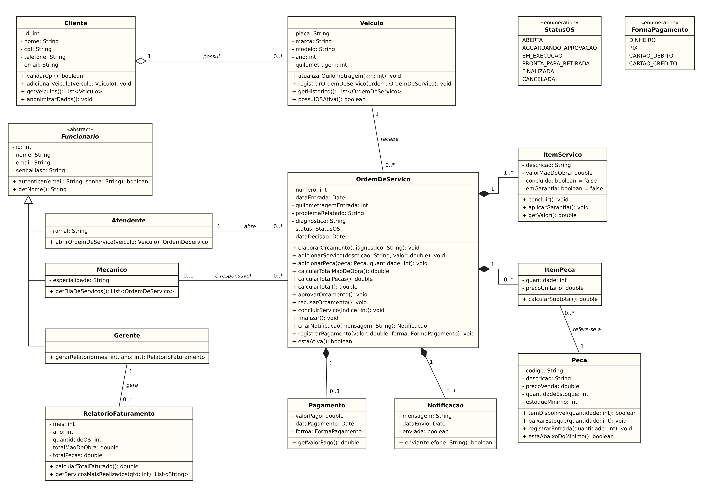

# MecaGest — Diagrama de Classes de Projeto

Arquivo editável: [`diagramas/classes.drawio`](diagramas/classes.drawio) (abrir no Draw.io).

## 1. Convenções adotadas

- **Atributos:** `visibilidade nome: tipo = valorInicial`. Todos são privados (`-`) e acessados pelos métodos públicos (`+`).
- **Métodos:** `visibilidade nome(parâmetro: tipo): tipoRetorno`.
- **Classe abstrata:** `Funcionario` aparece em itálico, com o estereótipo `«abstract»`. Ela nunca é instanciada diretamente, só por meio de `Atendente`, `Mecanico` e `Gerente`.
- **Enumerações:** `StatusOS` e `FormaPagamento` (estereótipo `«enumeration»`) definem os valores possíveis dos atributos `status` (em `OrdemDeServico`) e `forma` (em `Pagamento`).
- Nomes de classe no singular, como substantivos, sem acento (padrão de código).

## 2. Relacionamentos

| Relacionamento | Tipo | Multiplicidade | Justificativa |
| --- | --- | --- | --- |
| `Atendente`, `Mecanico`, `Gerente` → `Funcionario` | Generalização | — | Todos **são** funcionários: herdam nome, e-mail, senha e o método `autenticar()`. Cada um acrescenta o que é próprio do seu perfil (RN-08) |
| `Cliente` ◇— `Veiculo` | Agregação | 1 — 0..* | Um cliente possui zero ou mais veículos. O veículo **sobrevive sem o cliente**: se for vendido, continua no sistema com o seu histórico de OS |
| `Veiculo` — `OrdemDeServico` | Associação | 1 — 0..* | Um veículo recebe várias OS ao longo do tempo. Cada OS é de exatamente um veículo |
| `Atendente` — `OrdemDeServico` | Associação | 1 — 0..* | Registra quem abriu a OS |
| `Mecanico` — `OrdemDeServico` | Associação | 0..1 — 0..* | O mecânico responsável é definido quando ele assume a OS para fazer o orçamento. Por isso, uma OS recém-aberta ainda não tem mecânico (0..1) |
| `OrdemDeServico` ◆— `ItemServico` | Composição | 1 — 1..* | Os serviços orçados **não existem fora da OS**. Se a OS for excluída, eles são excluídos junto. Toda OS com orçamento tem pelo menos um serviço |
| `OrdemDeServico` ◆— `ItemPeca` | Composição | 1 — 0..* | Mesmo motivo: o item de peça é parte da OS. Pode haver zero itens, já que nem todo serviço usa peça |
| `ItemPeca` — `Peca` | Associação | 0..* — 1 | `ItemPeca` funciona como **classe associativa** entre a OS e a peça: guarda a quantidade e o preço unitário no momento do orçamento, para que uma mudança futura no preço não altere orçamentos antigos |
| `OrdemDeServico` ◆— `Pagamento` | Composição | 1 — 0..1 | O pagamento só existe vinculado à OS. Antes de pago, não há pagamento (0) |
| `OrdemDeServico` ◆— `Notificacao` | Composição | 1 — 0..* | Cada tentativa de aviso ao cliente fica registrada na OS. Pode haver mais de uma se a primeira falhar |
| `Gerente` — `RelatorioFaturamento` | Associação | 1 — 0..* | Registra qual gerente gerou cada relatório |

## 3. Rastreabilidade: classes x casos de uso e requisitos

| Classe | Principais casos de uso | Requisitos e regras |
| --- | --- | --- |
| `Funcionario`, `Atendente`, `Mecanico`, `Gerente` | Autenticar Usuário | RF-01, RNF-03 (`senhaHash`), RN-08 |
| `Cliente` | Cadastrar Cliente | RF-02, RN-01 (`validarCpf()`), RNF-07 (`anonimizarDados()`) |
| `Veiculo` | Cadastrar Veículo, Consultar Veículo, Consultar Histórico do Veículo | RF-03, RF-13 (`getHistorico()`), RN-02, RN-03 (`possuiOSAtiva()`) |
| `OrdemDeServico` | Abrir OS, Elaborar Orçamento, Registrar Aprovação, Finalizar OS | RF-04 a RF-07, RN-04, RN-05, RN-06 |
| `ItemServico` | Elaborar Orçamento, Aplicar Garantia, Registrar Execução | RF-05, RF-07, RN-07 (`aplicarGarantia()`) |
| `ItemPeca`, `Peca` | Elaborar Orçamento, Baixar Peças, Emitir Alerta, Gerenciar Estoque | RF-08, RF-09, RF-10 (`estaAbaixoDoMinimo()`), RN-05 (`temDisponivel()`) |
| `Pagamento` | Registrar Pagamento | RF-12, RN-06 |
| `Notificacao` | Notificar Cliente | RF-11 |
| `RelatorioFaturamento` | Gerar Relatório de Faturamento | RF-14 |

## 4. Como as regras de negócio aparecem nos métodos

- `OrdemDeServico.aprovarOrcamento()` chama `temDisponivel()` de cada peça antes de aprovar (RN-05) e, ao aprovar, chama `baixarEstoque()` (RF-08).
- `ItemServico.concluir()` só é permitido se o status da OS for `EM_EXECUCAO` (RN-04).
- `OrdemDeServico.finalizar()` exige que todos os `ItemServico` estejam com `concluido = true`, muda o status para `PRONTA_PARA_RETIRADA` e cria uma `Notificacao` (RF-11).
- `OrdemDeServico.registrarPagamento()` cria o `Pagamento` e só então muda o status para `FINALIZADA` (RN-06).
- `Veiculo.possuiOSAtiva()` é consultado por `Atendente.abrirOrdemDeServico()` para impedir duas OS ativas no mesmo veículo (RN-03).
